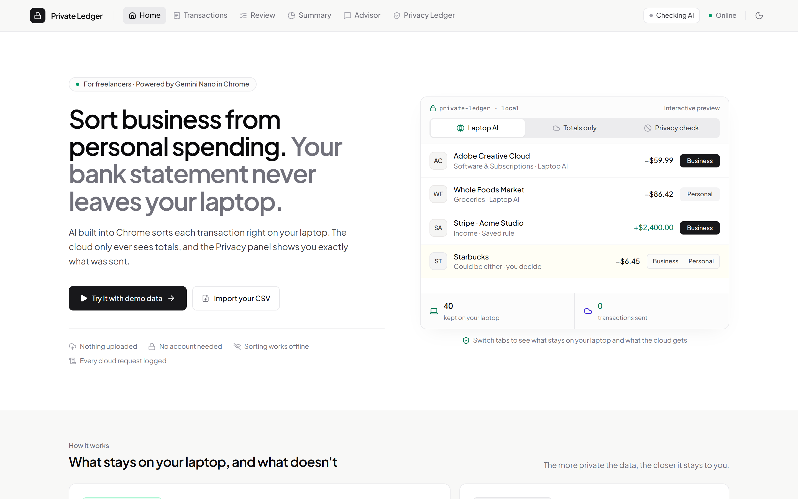
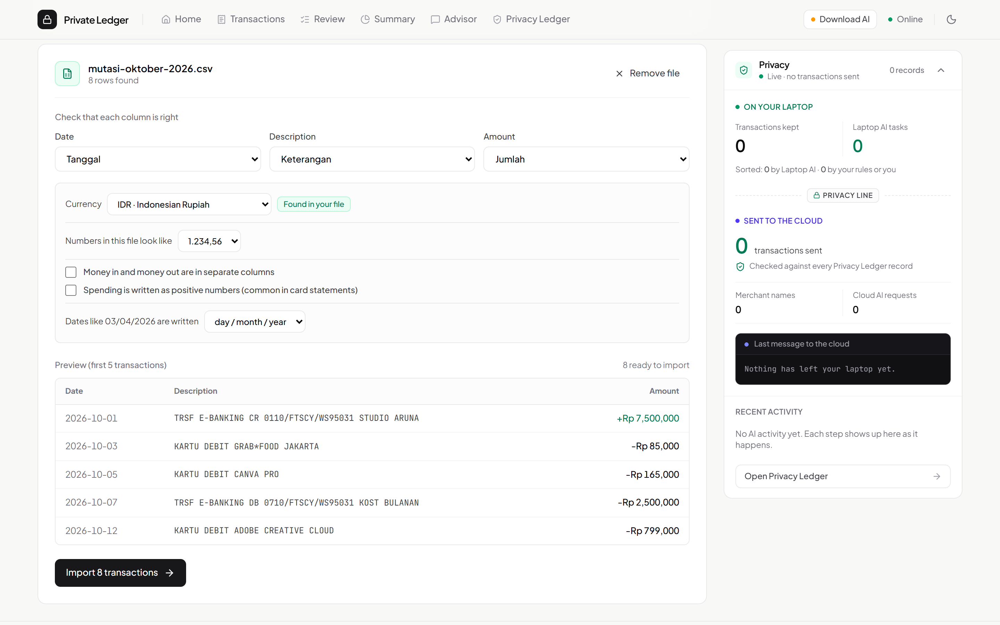
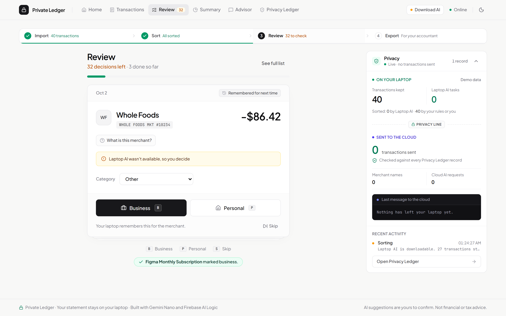
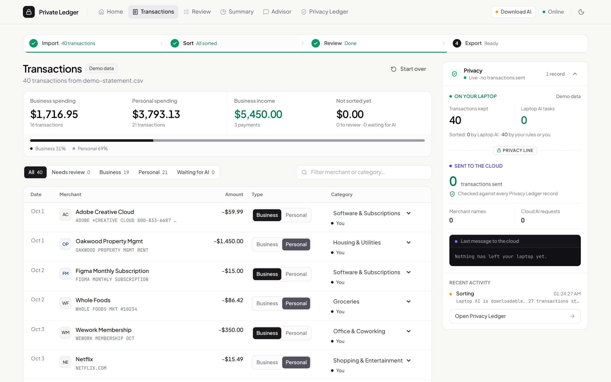
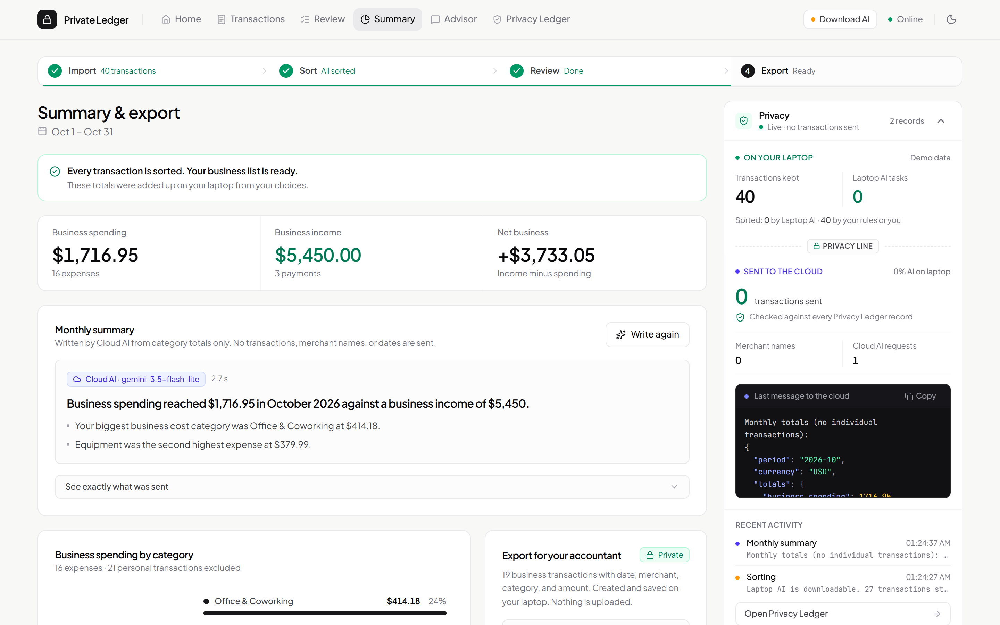
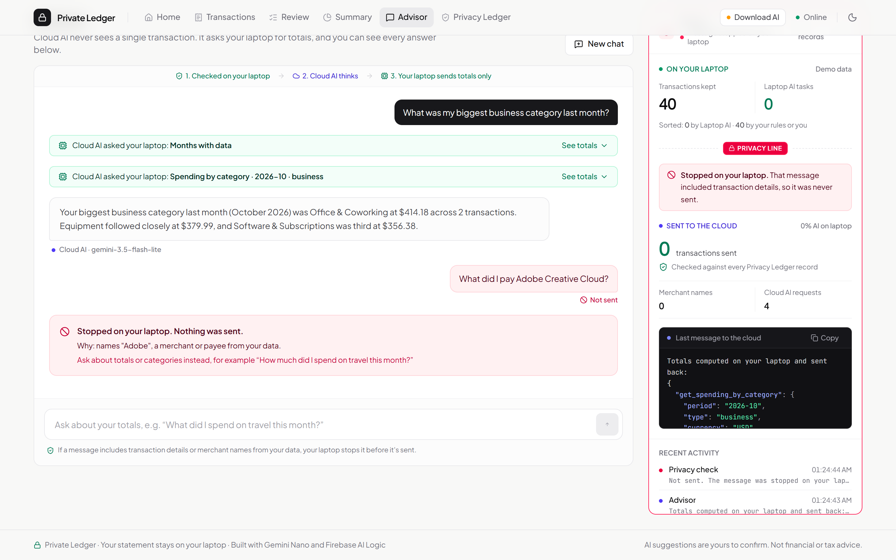
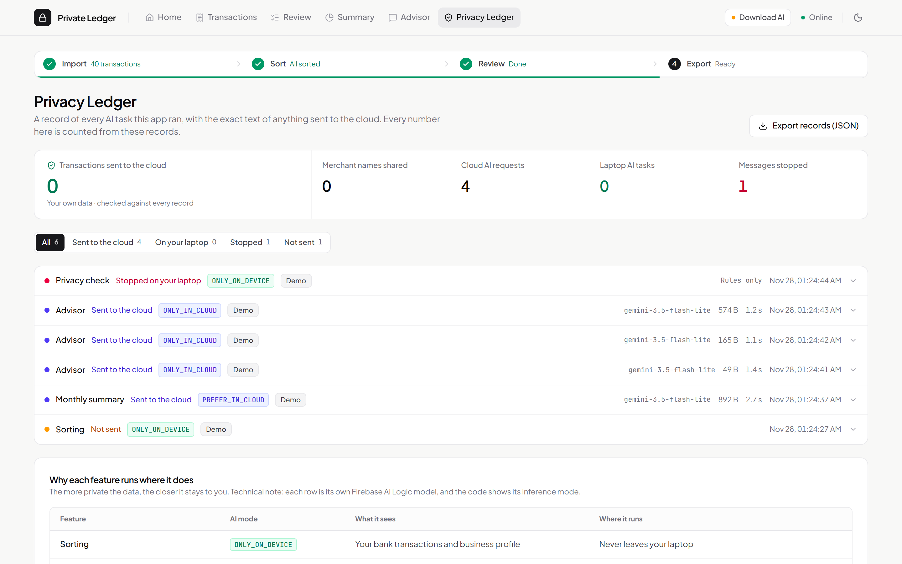
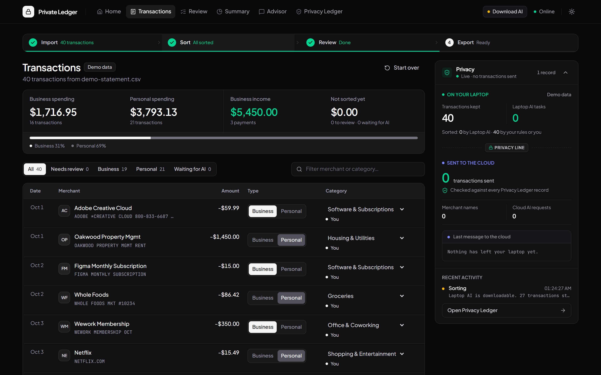
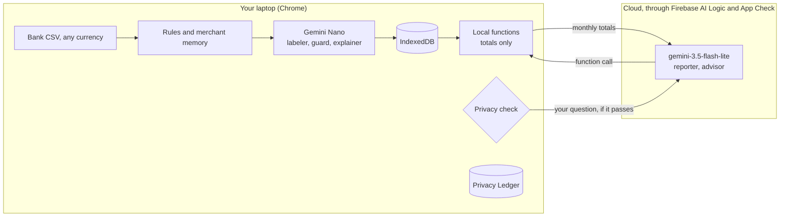

# Private Ledger

**Your bank statement never leaves your laptop. The cloud only gets the math.**

Private Ledger helps freelancers separate business from personal spending in a bank CSV, in their own currency. Gemini Nano sorts every transaction inside Chrome. The cloud model only receives totals, and it can only reach your data by calling functions that run on your laptop. A Privacy Ledger records every AI task, with the exact text of each request that left the laptop.

Built for [#BuildHybridAI 2026](https://firebasehybridaihackathon.devpost.com/) with **Firebase AI Logic** hybrid inference. Platform: Web (Chrome desktop).

- Live app: https://private-ledger.web.app
- Demo video: https://youtu.be/SxASQV2i_28



## The problem

Freelancers export bank CSVs because they do not want to link their accounts or upload statements that reveal client names and income. Then they sort every row by hand to produce one thing: a clean list of business expenses for their accountant.

Private Ledger does that one job. Import a CSV, sort every transaction, check the unclear ones, and export the business list. No transaction is uploaded along the way.

## What is different

**1. A privacy line you can inspect, not a promise.** A Privacy panel sits next to the work on every screen. One side shows what stays on the laptop. The other shows what was sent to the cloud: the exact text of the last request and a counter of transactions sent. Every number is computed from the Privacy Ledger. The ledger screen lists every AI task with its inference mode, model, size, duration, and the text that was sent. It can be exported as JSON.

**2. The cloud thinks; only the laptop touches the data.** The advisor is a cloud chat model with function calling. Its functions (`get_spending_by_category`, `compare_periods`, and four more) run in the browser against IndexedDB and return totals only. The chat shows each call and the exact totals the laptop answered with. Before a message is sent, a privacy check on the laptop reads it. A pasted statement line, or a question that names a merchant from your data, is stopped and never sent.

**3. Plain language, in your currency.** The app is written for freelancers, not engineers: Laptop AI, Cloud AI, sort, "with your OK". Statements in rupiah, euros, rupees, or any other currency import with the right amounts and stay in that currency.

## Screenshots

Taken from the 40-row demo statement and a sample rupiah statement. Every merchant line and amount in them is invented. These were captured in a Chrome without Gemini Nano, which is why the header offers to download the AI and the demo rows were sorted by hand in Review.

| | |
|---|---|
|  **Import in your currency.** The currency and the number format are read from the file; the preview shows rupiah before anything is saved. |  **Review.** One card at a time, with keyboard shortcuts. A decision is remembered for that merchant. |
|  **Transactions.** Totals, filters, and the Privacy panel. 40 transactions kept on the laptop, 0 sent. |  **Summary.** Cloud AI writes the monthly summary from category totals only, and the panel shows exactly what was sent. |
|  **Advisor.** Cloud AI asks the laptop for totals. A question that names a merchant from your data is stopped before it is sent. |  **Privacy Ledger.** Every AI task, its inference mode, and the exact text that left the laptop. |

<details>
<summary>Dark mode</summary>



</details>

## How it uses Firebase AI Logic

Every AI call goes through the Firebase AI Logic Web SDK. There is one model instance per inference configuration, all defined in [`app/src/lib/ai/models.ts`](app/src/lib/ai/models.ts). The inference mode of each instance follows the sensitivity of the data it handles.

| Feature | Instance | Inference mode | Data it is given | Why this mode |
|---|---|---|---|---|
| Sort business or personal | `labeler` | `ONLY_ON_DEVICE` | Bank transactions, business profile | Transactions must never have a cloud path |
| Privacy check on outgoing messages | `guard` | `ONLY_ON_DEVICE` | The chat message, before sending | The check has to happen before anything leaves |
| What is this merchant? | `explainer` | `PREFER_ON_DEVICE` | One cleaned merchant name | A name is better kept local; the cloud is used only with your OK |
| Monthly summary | `reporter` | `PREFER_IN_CLOUD` | Totals per category for one month, with the currency code | Totals are safe to send and the cloud writes better; Gemini Nano takes over when the cloud cannot answer |
| Advisor chat | `advisor` | `ONLY_IN_CLOUD` | Your question, totals from local functions | Multi-turn chat and function calling only exist in the cloud |
| Cloud sorting (fallback) | `consentLabeler` | `ONLY_IN_CLOUD` | One bank description per merchant | Only when Laptop AI is unavailable and you explicitly agree |

SDK capabilities in use:

- All four hybrid modes, with `inferenceSource` read from every response and written to the ledger. The label on each result comes from what the SDK reports, not from what the app expected.
- `initializeDeviceModel()` from a click, with download progress.
- Structured output on both sides: `responseConstraint` for Gemini Nano, `responseSchema` for the cloud model.
- Streaming on-device. Sorted transactions appear one by one while the model is still writing.
- Multi-turn chat with function calling, where the functions execute locally.
- App Check: reCAPTCHA Enterprise (or reCAPTCHA v3) in production, a debug token in development only.
- A 20-second timeout on every cloud request, and retries with exponential backoff on 429, 500, and 503.



## How sorting works

A test with Gemini Nano on 40 synthetic rows (21 Nov 2026, Chrome 158, RTX 4050 6 GB) shaped this pipeline. Accuracy on clear rows was good (30 of 33). But the model never answered "unsure": 0 of 7 ambiguous rows, and it sorted a savings transfer and a warehouse club as business with high confidence. So the review queue is decided by rules, not by the model's confidence.

1. **Normalize the merchant.** `STARBUCKS STORE 1123` and `STARBUCKS STORE 0988` become one merchant. Card and transfer prefixes that banks write before the merchant are dropped, so `KARTU DEBIT GRAB*FOOD` becomes Grab Food and `TRSF E-BANKING DB 0710/FTSCY/WS95031 KOST BULANAN` becomes Kost Bulanan.
2. **Merchant memory.** A merchant you corrected before is sorted from your answer, with no inference.
3. **Deterministic rules.** Transfers between your accounts, payment-app transfers to a person, payroll, client payouts, and bank fees never reach a model.
4. **Mixed-use list.** Marketplaces, airlines, coffee shops, fuel, app stores, and similar merchants always go to the review queue, whatever a model would say.
5. **Gemini Nano, once per unique merchant.** Batches of 10 with streaming. In the same test the first row appeared after 2.0 s, where a non-streaming batch of 20 showed nothing for 27 to 36 s.

For the 40-row demo statement, rules sort 13 rows and the model sees 27 unique merchants.

## Works in your currency

- **The file says which currency it is in.** The importer looks for a currency column (`Currency`, `Mata Uang`, `Währung`), then for symbols or codes in the amounts (`Rp 85.000`, `1.234,56 €`, `₹`, `RM`, `IDR`), then for a code in a column name (`Amount (EUR)`). The import screen shows what it found, marked "Found in your file" or "Please check", and you can change it. A bare `$` or `¥` is used by several currencies, so it only counts as a guess.
- **Numbers are read the way the bank wrote them.** The decimal mark is decided from the whole column, so `Rp 25.000` is 25000 and `1.234,56` is 1234.56. Debit and credit markers such as `DR`, `DB`, and `CR` are understood. Column names in Indonesian, German, French, Spanish, and Dutch are recognized.
- **One ledger, one currency.** Amounts in two currencies cannot be added up without an exchange rate, and fetching rates would mean a network call. A file in another currency replaces the transactions after a clear warning, and keeps your merchant memory and the Privacy Ledger. Rows that a currency column puts in another currency are skipped and counted.
- **Shown in that currency everywhere.** Amounts use the browser's number format, and rupiah is shown in whole units. The advisor functions, the monthly summary payload, and the CSV export all carry the currency code, and the cloud prompts tell the model never to convert.

## Engineering notes

**`ONLY_ON_DEVICE` can reach the cloud.** In Firebase JS SDK 13.2.0, when the browser has no `LanguageModel` API (Firefox, Safari, Chrome without the flag), a model created with `ONLY_ON_DEVICE` gets no on-device adapter and the request is sent to the default cloud model. Every on-device call in this app first passes `assertOnDeviceReady()` in [`onDevice.ts`](app/src/lib/ai/onDevice.ts), which refuses the request instead. The ledger records a refusal as "Not sent".

**`PREFER_IN_CLOUD` falls back on any failed request, not only offline.** A 429 or 503 from the cloud also makes the SDK fall back to Gemini Nano. The totals were still sent in that case, so the ledger records both the cloud attempt and the on-device call.

**A failed `sendMessage` breaks the SDK's `ChatSession` for good.** Later calls on the same session reject with the old error. The advisor keeps its own copy of the history and builds a fresh session for every request, so a timeout or a retry never corrupts the conversation ([`advisor.ts`](app/src/lib/ai/advisor.ts)).

**A first AI call made offline could switch App Check off for the whole visit.** Firebase and App Check are set up on the first AI call. Sorting works offline, so that call can happen without a connection, and the App Check SDK (13.2.0) adds its reCAPTCHA script with no handler for a failed load. Every later cloud request then waited for a token that could not come, until the page was reloaded. The app watches that script and loads it again when the connection returns ([`firebase.ts`](app/src/lib/ai/firebase.ts)), so sorting offline and then asking Cloud AI works in one visit.

**It installs as an app and starts offline.** Private Ledger is an installable web app. A service worker, generated at build time with the exact file list of that build, caches only the app's own files, so the installed app opens without a connection and sorting keeps working. Requests to Firebase AI Logic, App Check, and reCAPTCHA are never cached or touched by the worker.

**The browser enforces the privacy line too.** `firebase.json` sends a Content-Security-Policy whose `connect-src` only allows Firebase AI Logic, App Check, and reCAPTCHA, so the page cannot send data anywhere else. `npm run preview:hosting` serves the production build with the same headers for a local check.

**The App Check debug token cannot reach a production bundle.** It lives in `.env.development.local`, which `vite build` does not read, and the code that uses it is removed from production builds.

**Colors live in one place.** Every screen uses semantic color tokens (`surface`, `fg-muted`, `device`, `cloud`, `review`, `danger`, …) defined once for light and dark in [`index.css`](app/src/index.css). A palette change is a change to that file.

## Try it

**With Laptop AI (the real experience)**

1. Use Chrome on a desktop computer. Chrome's documentation asks for a GPU with more than 4 GB of VRAM and about 22 GB of free disk space.
2. Open `chrome://flags`, enable **Gemma 4 for Built-in AI**, and relaunch. If the app still reports the API as missing, also enable **Prompt API for Gemini Nano**.
3. Open the app, click **Try it with demo data**, and download the AI when asked. Sorting starts by itself when it is ready.

**Without Laptop AI**

The demo still works. Saved rules sort part of it, and for the rest you choose: sort by hand in Review, or send the demo rows to Cloud AI after seeing exactly what will be sent. Demo rows sent this way are counted separately from your own data. Nothing moves to the cloud on its own.

Then write the monthly summary, ask the advisor a question, and paste a line from the demo into the chat to watch the privacy check stop it. To see currencies at work, import [`samples/statement-rupiah.csv`](samples/statement-rupiah.csv) (an Indonesian bank format), [`samples/statement-euro.csv`](samples/statement-euro.csv) (a German bank format), or [`samples/statement-usd.csv`](samples/statement-usd.csv) (a US bank format). All three are invented. You can also use a statement from your own bank.

## Run it locally

Requires Node.js 22.13 or newer.

```bash
cd app
npm install
npm run dev        # http://localhost:5174
```

The app runs without any Firebase project: Laptop AI features work, and cloud features are switched off. To turn on the cloud features:

1. Create a Firebase project, enable **AI Logic** with the Gemini Developer API, and register a web app.
2. Copy `app/.env.example` to `app/.env.local` and fill in the web config.
3. In **App Check**, add a debug token for the web app and put it in `app/.env.development.local`:

   ```
   VITE_APPCHECK_DEBUG_TOKEN=your-debug-token
   ```

Checks:

```bash
npm test           # CSV parsing, currency detection, sorting rules, privacy check rules; no model needed
npm run typecheck
npm run lint       # includes the layer rules for src/lib
npm run build
```

GitHub Actions runs the same checks on every push and pull request ([`.github/workflows/ci.yml`](.github/workflows/ci.yml)). It also builds once with a fake App Check debug token in the environment and fails if that token appears in the output.

## Deploy

1. Create a score-based reCAPTCHA Enterprise key for your hosting domain and register it for the web app in **App Check**. Do not add `localhost` to that key.
2. Put the site key in `app/.env.local` as `VITE_RECAPTCHA_ENTERPRISE_SITE_KEY` (or `VITE_RECAPTCHA_V3_SITE_KEY` for a reCAPTCHA v3 key).
3. Deploy from the repository root:

   ```bash
   npm install -g firebase-tools
   firebase login
   firebase deploy --only hosting --project your-project-id
   ```

`firebase.json` builds `app/` and serves `app/dist` with a Content-Security-Policy and other security headers. To check the production build with those headers before deploying:

```bash
cd app
npm run build
npm run preview:hosting   # http://localhost:5180
```

## Project structure

`app/src/lib` is split into layers, and each layer may only import from the layers listed after it. ESLint enforces this (`npm run lint`).

```
app/src/
  views/          Home, Import, Transactions, Review, Summary, Advisor, Privacy Ledger
  components/     Privacy panel, consent prompts, shared UI
  lib/state/      navigation, user actions, model status, journey progress
  lib/ai/         everything that calls Firebase AI Logic
    firebase.ts       app and App Check
    models.ts         the six model instances and their inference modes
    onDevice.ts       on-device availability and assertOnDeviceReady()
    cloudCall.ts      timeout, retry with backoff, one ledger entry per attempt
    labeler.ts, labelingRunner.ts   streaming on-device sorting
    consentLabeling.ts              cloud sorting, only with your OK
    guard.ts          privacy check on outgoing messages (rules, then Gemini Nano)
    explainer.ts      "What is this merchant?" with the consent gate
    reporter.ts       monthly summary from totals
    advisor.ts, advisorStore.ts, localFunctions.ts   cloud chat with local function calling
  lib/data/       IndexedDB (Dexie), Privacy Ledger, import, export
  lib/core/       pure logic with no browser API and no model: CSV parsing, currency
                  detection, merchant normalization, sorting rules, privacy check rules,
                  taxonomy, demo data
  lib/util/       small shared helpers: money formatting, the ledger currency
app/scripts/      tests that run in Node, and the local hosting preview
spike/go-no-go/   the test page used to check on-device and cloud inference before building
docs/screenshots/ the screenshots in this README
samples/          invented bank statements in rupiah, euros, and US dollars, for trying the importer
```

There is no backend. Transactions, merchant memory, and the ledger live in IndexedDB in your browser. The only network destinations are Firebase AI Logic and App Check, which loads reCAPTCHA in production.

## Known limits

- **The privacy check is a filter, not a proof.** It stops amounts with dates, statement-style text, and merchants or payees found in your imported data. It recognizes amounts in the common currencies, such as `$29`, `Rp 85.000`, `1.234,56 €`, and `IDR 54.990`. It does not catch a name that is not in your data, a merchant made only of common words when it stands alone (for example "Target"), or names shorter than four letters on their own. Your question itself is sent to the cloud once it passes.
- **Rule tests are small.** Set A (8 unsafe, 8 safe messages) was written after rules v1 were locked. Set B was written before rule v2 and only shows that gap is closed. Set C covers amounts in other currencies and was written together with rules v3, so it shows the patterns work, not that they generalize. All three are in [`app/scripts/g9.ts`](app/scripts/g9.ts).
- **One currency per ledger.** Amounts are never converted. A statement in a second currency replaces the first, and a mixed file keeps only the currency you choose. The demo statement is in US dollars.
- **CSV formats.** Common numeric and month-name dates are read. For dates like `03/04/2026` the order is detected per file and can be changed before importing. When a file does not name its currency, the browser's region decides the first guess, and the import screen asks you to check it.
- **Laptop AI needs capable hardware** and, for now, a Chrome flag.
- **Retries are logged per attempt.** If a request sent with your OK is retried, its transactions are counted once per transmission.
- **Free-tier quota.** Cloud features use `gemini-3.5-flash-lite` without billing and can run out. The app says so and keeps working on the laptop.
- **Sorting suggestions are yours to confirm.** This is not financial or tax advice.

## Built during the contest

Private Ledger is a new project. All of it, including the test page in `spike/go-no-go`, was written during the contest period in November 2026.

## License

[Apache License 2.0](LICENSE)
