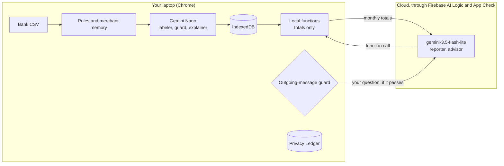

# Private Ledger

**Your bank statement never leaves your laptop. The cloud only gets the math.**

Private Ledger helps freelancers separate business from personal spending in a bank CSV. Gemini Nano labels every transaction inside Chrome. The cloud model only receives totals, and it can only reach your data by calling functions that run on your device. A Privacy Ledger shows every AI call and the exact payload of each request that left the device.

Built for [#BuildHybridAI 2026](https://firebasehybridaihackathon.devpost.com/) with **Firebase AI Logic** hybrid inference. Platform: Web (Chrome desktop).

- Live app: _link added at submission_
- Demo video: _link added at submission_

## The problem

Freelancers export bank CSVs because they do not want to link their accounts or upload statements that reveal client names and income. Then they sort every row by hand to produce one thing: a clean list of business expenses for their accountant.

Private Ledger does that one job: import a CSV, label every row, review the unclear ones, export the business list. No row is uploaded along the way.

## What is different

**1. A boundary you can inspect, not a promise.** A Data Boundary panel sits next to the work on every screen. One side shows what stays on the device. The other shows what was sent to the cloud, including the exact payload of the last request and a counter of raw transactions sent. Every number is computed from the Privacy Ledger. The ledger screen lists every call with its inference mode, model, size, duration, and payload, and it can be exported as JSON.

**2. The cloud thinks; only the device touches the data.** The advisor is a cloud chat model with function calling. Its functions (`get_spending_by_category`, `compare_periods`, and four more) run in the browser against IndexedDB and return totals only. The chat shows each call and the exact totals the device answered with. Before a message is sent, a guard on the device checks it. A pasted statement row, or a question that names a merchant from your data, is blocked and never sent.

## How it uses Firebase AI Logic

Every AI call goes through the Firebase AI Logic Web SDK. There is one model instance per inference configuration, all defined in [`app/src/lib/models.ts`](app/src/lib/models.ts). The inference mode of each instance follows the sensitivity of the data it handles.

| Feature | Instance | Inference mode | Data it is given | Why this mode |
|---|---|---|---|---|
| Label business or personal | `labeler` | `ONLY_ON_DEVICE` | Raw bank rows, business profile | Raw rows must never have a cloud path |
| Outgoing-message guard | `guard` | `ONLY_ON_DEVICE` | The chat message, before sending | The check has to happen before anything leaves |
| What is this merchant? | `explainer` | `PREFER_ON_DEVICE` | One cleaned merchant name | A name is better kept local; the cloud is used only if you agree |
| Monthly summary | `reporter` | `PREFER_IN_CLOUD` | Totals per category for one month | Totals are safe to send and the cloud writes better; Gemini Nano takes over when the cloud cannot answer |
| Advisor chat | `advisor` | `ONLY_IN_CLOUD` | Your question, totals from local functions | Multi-turn chat and function calling only exist in the cloud |
| Fallback labeling | `consentLabeler` | `ONLY_IN_CLOUD` | One bank description per merchant | Only when on-device AI is unavailable and you explicitly agree |

SDK capabilities in use:

- All four hybrid modes, with `inferenceSource` read from every response and written to the ledger. The label on each result comes from what the SDK reports, not from what the app expected.
- `initializeDeviceModel()` from a click, with download progress.
- Structured output on both sides: `responseConstraint` for Gemini Nano, `responseSchema` for the cloud model.
- Streaming on-device. Labeled rows appear one by one while the model is still writing.
- Multi-turn chat with function calling, where the functions execute locally.
- App Check: reCAPTCHA Enterprise (or reCAPTCHA v3) in production, a debug token in development only.
- A 20-second timeout on every cloud request, and retries with exponential backoff on 429, 500, and 503.



## How labeling works

A test with Gemini Nano on 40 synthetic rows (21 Nov 2026, Chrome 158, RTX 4050 6 GB) shaped this pipeline. Accuracy on clear rows was good (30 of 33). But the model never answered "unsure": 0 of 7 ambiguous rows, and it labeled a savings transfer and a warehouse club as business with high confidence. So the review queue is decided by rules, not by the model's confidence.

1. **Normalize the merchant.** `STARBUCKS STORE 1123` and `STARBUCKS STORE 0988` become one merchant.
2. **Merchant memory.** A merchant you corrected before is labeled from your answer, with no inference.
3. **Deterministic rules.** Transfers between your accounts, payment-app transfers to a person, payroll, client payouts, and bank fees never reach a model.
4. **Mixed-use list.** Marketplaces, airlines, coffee shops, fuel, app stores, and similar merchants always go to the review queue, whatever a model would say.
5. **Gemini Nano, once per unique merchant.** Batches of 10 with streaming. In the same test the first row appeared after 2.0 s, where a non-streaming batch of 20 showed nothing for 27 to 36 s.

For the 40-row demo statement, rules label 13 rows and the model sees 27 unique merchants.

## Engineering notes

**`ONLY_ON_DEVICE` can reach the cloud.** In Firebase JS SDK 13.2.0, when the browser has no `LanguageModel` API (Firefox, Safari, Chrome without the flag), a model created with `ONLY_ON_DEVICE` gets no on-device adapter and the request is sent to the default cloud model. Every on-device call in this app first passes `assertOnDeviceReady()` in [`onDevice.ts`](app/src/lib/onDevice.ts), which refuses the request instead. The ledger records a refusal as "Not sent".

**`PREFER_IN_CLOUD` falls back on any failed request, not only offline.** A 429 or 503 from the cloud also makes the SDK fall back to Gemini Nano. The totals were still sent in that case, so the ledger records both the cloud attempt and the on-device call.

**A failed `sendMessage` breaks the SDK's `ChatSession` for good.** Later calls on the same session reject with the old error. The advisor keeps its own copy of the history and builds a fresh session for every request, so a timeout or a retry never corrupts the conversation ([`advisor.ts`](app/src/lib/advisor.ts)).

**The browser enforces the boundary too.** `firebase.json` sends a Content-Security-Policy whose `connect-src` only allows Firebase AI Logic, App Check, and reCAPTCHA, so the page cannot send data anywhere else. `npm run preview:hosting` serves the production build with the same headers for a local check.

**The App Check debug token cannot reach a production bundle.** It lives in `.env.development.local`, which `vite build` does not read, and the code that uses it is removed from production builds.

## Try it

**With on-device AI (the real experience)**

1. Use Chrome on a desktop computer. Chrome's documentation asks for a GPU with more than 4 GB of VRAM and about 22 GB of free disk space.
2. Open `chrome://flags`, enable **Gemma 4 for Built-in AI**, and relaunch. If the app still reports the API as missing, also enable **Prompt API for Gemini Nano**.
3. Open the app, click **Try it with demo data**, and download the model when asked. Labeling starts by itself when the model is ready.

**Without on-device AI**

The demo still works. Rules label part of it, and for the rest you choose: label by hand, or send the demo rows to the cloud after seeing exactly what will be sent. Demo rows sent this way are counted separately from your own data. Nothing moves to the cloud on its own.

Then try the summary, ask the advisor a question, and paste a row from the demo into the chat to watch the guard block it.

## Run it locally

Requires Node.js 22.12 or newer.

```bash
cd app
npm install
npm run dev        # http://localhost:5174
```

The app runs without any Firebase project: on-device features work, and cloud features are switched off. To turn on the cloud features:

1. Create a Firebase project, enable **AI Logic** with the Gemini Developer API, and register a web app.
2. Copy `app/.env.example` to `app/.env.local` and fill in the web config.
3. In **App Check**, add a debug token for the web app and put it in `app/.env.development.local`:

   ```
   VITE_APPCHECK_DEBUG_TOKEN=your-debug-token
   ```

Checks:

```bash
npm test           # CSV parsing, labeling rules, guard rules; no model needed
npm run typecheck
npm run build
```

## Deploy

1. Create a score-based reCAPTCHA Enterprise key for your hosting domain and register it for the web app in **App Check**. Do not add `localhost` to that key.
2. Put the site key in `app/.env.local` as `VITE_RECAPTCHA_ENTERPRISE_SITE_KEY` (or `VITE_RECAPTCHA_V3_SITE_KEY` for a reCAPTCHA v3 key).
3. Deploy from the repository root:

   ```bash
   npm install -g firebase-tools
   firebase login
   firebase deploy --only hosting --project your-project-id
   ```

`firebase.json` builds `app/` and serves `app/dist` with a Content-Security-Policy and other security headers. To check the production build with those headers before deploying:

```bash
cd app
npm run build
npm run preview:hosting   # http://localhost:5180
```

## Project structure

```
app/
  src/lib/models.ts          all six Firebase AI Logic model instances
  src/lib/onDevice.ts        on-device availability and the assertOnDeviceReady() guard
  src/lib/labeler.ts         streaming on-device labeling
  src/lib/prepare.ts         normalize, merchant memory, rules, dedupe (no model)
  src/lib/rules.ts           deterministic rules and the mixed-use list
  src/lib/guard.ts           outgoing-message guard (rules, then Gemini Nano)
  src/lib/guardRules.ts      the rule layer of the guard
  src/lib/explainer.ts       "What is this merchant?" with the consent gate
  src/lib/reporter.ts        monthly summary from totals
  src/lib/advisor.ts         cloud chat with local function calling
  src/lib/localFunctions.ts  the functions the advisor may call
  src/lib/consentLabeling.ts cloud labeling, only after consent
  src/lib/cloudCall.ts       timeout, retry with backoff, ledger entry per attempt
  src/lib/ledger.ts          Privacy Ledger entries and counters
  src/lib/db.ts              IndexedDB schema (Dexie)
  src/views/                 Home, Import, Transactions, Review, Summary, Advisor, Privacy Ledger
  src/components/            Data Boundary panel, consent dialog, shared UI
  scripts/                   tests that run in Node, and the local hosting preview
spike/go-no-go/              the test page used to check on-device and cloud inference before building
```

There is no backend. Transactions, merchant memory, and the ledger live in IndexedDB in your browser. The only network destinations are Firebase AI Logic and App Check, which loads reCAPTCHA in production.

## Known limits

- **The guard is a filter, not a proof.** It blocks amounts with dates, statement-style text, and merchants or payees found in your imported data. It does not catch a name that is not in your data, a merchant made only of common words when it stands alone (for example "Target"), or names shorter than four letters on their own. Your question itself is sent to the cloud once it passes.
- **Rule tests are small.** Set A (8 unsafe, 8 safe messages) was written after rules v1 were locked. Set B was written before rule v2 and only shows that gap is closed. Both are in [`app/scripts/g9.ts`](app/scripts/g9.ts).
- **CSV formats.** Common numeric and month-name dates are read. For dates like `03/04/2026` the order is detected per file and can be changed before importing. Amounts are treated as US dollars, in one currency.
- **On-device AI needs capable hardware** and, for now, a Chrome flag.
- **Retries are logged per attempt.** If a consented request is retried, its rows are counted once per transmission.
- **Free-tier quota.** Cloud features use `gemini-3.5-flash-lite` without billing and can run out. The app says so and keeps working on the device.
- **Labels are suggestions you confirm.** This is not financial or tax advice.

## Built during the contest

Private Ledger is a new project. All of it, including the test page in `spike/go-no-go`, was written during the contest period in November 2026.

## License

[Apache License 2.0](LICENSE)
